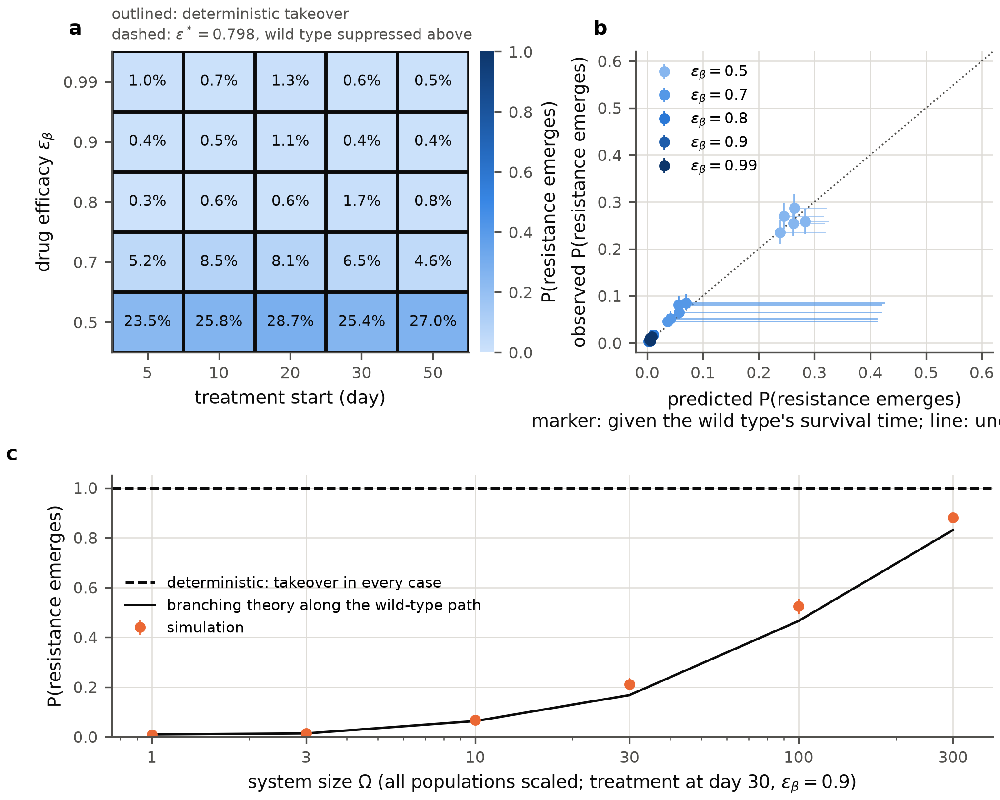

<h1 align="center">Stochastic viral dynamics</h1>

<p align="center">
Exact stochastic simulation of a two-strain within-host viral model with an effector response,<br>
against its deterministic limit and branching-process theory.
</p>

<p align="center">
  <a href="https://arxiv.org/abs/XXXX.XXXXX"></a>
  <a href="https://doi.org/10.5281/zenodo.23737030"></a>
  <a href="https://github.com/GaiaGro/stochastic-viral-dynamics/actions/workflows/ci.yml"></a>
  <a href="LICENSE"></a>
  
</p>

<p align="center">
Gaia Grossi and Leonardo Vanni, Bocconi University
</p>

---

Deterministic within-host models describe an infection as continuous quantities that never reach zero. At three moments the real numbers are small: the inoculum, the first effector cells, and the mutant lineages that appear under therapy. This repository simulates a standard two-strain model with a cytotoxic effector response exactly, with the Gillespie algorithm, and compares the outcomes with the deterministic solution and with branching-process and birth--death theory. Where the deterministic model predicts certain establishment above $R_0 = 1$, certain clearance in the acute regime and certain takeover by a resistant mutant under therapy, the exact process gives probabilities, and each of them is predicted by a closed-form or birth--death argument.

<p align="center">
  
</p>

## Findings

- **Establishment.** A single virion at $R_0 = 33$ establishes an infection in 82 % of realisations, as the closed form $\pi(1 - 1/R_0)$ predicts; at $R_0 = 3.4$ it establishes in 5.5 %. The branching prediction lies inside the 95 % interval in 64 of 68 conditions.
- **Immune activation can fail.** With one founding effector cell, the response that clears the infection deterministically never starts in 5.1 % of established infections (Kendall's formula: 4.5 %), and the infection settles at the set point it would have without immunity. The effector death rate, not the proliferation rate, is the lever.
- **Resistance is not inevitable.** In a 5 × 5 grid of treatment start and efficacy the deterministic model predicts mutant takeover in every cell; the exact process gives 0.3 to 1.7 % whenever the drug suppresses the wild type, and cure in at least 98 % of realisations. One branching prediction along the wild-type path matches every cell, and takeover becomes likely only when every population is scaled up by a factor of a few hundred.
- **Regime maps are probabilities.** Across the plane of infectivity and killing rate the deterministic model calls 370 cells chronic; the infection never persists to day 200 in 113 of them and persists in more than 95 % of realisations in only 45.
- **One quantity organises all of it.** The activation threshold $I^* = d_E/q$ is also the chronic set point of infected cells; a deterministic chronic state of one or two cells does not exist stochastically.

## Installation

```bash
git clone https://github.com/GaiaGro/stochastic-viral-dynamics.git
cd stochastic-viral-dynamics
make install          # creates .venv with uv and installs the package
make test             # 85 tests, about 20 s
make figures          # every figure, from the committed results, no simulation
```

Without [uv](https://docs.astral.sh/uv/): `python3 -m venv .venv && .venv/bin/pip install -r requirements-lock.txt -e .`

## Usage

```python
import numpy as np
from viraldyn import PRESETS, simulate, solve_ode, r0_wild_type, suppression_efficacy

p = PRESETS["resistance"]
print(r0_wild_type(p), suppression_efficacy(p))        # 4.76, 0.798

t = np.linspace(0, 150, 1501)
x0 = [1000, 10, 0, 0, 0, 10]                            # T, Iw, Im, Vw, Vm, E
ode = solve_ode(p, x0, t)                                # deterministic solution on the grid
run = simulate(p, x0, t, seed_value=1)                   # one exact realisation
run.X, run.t_ext                                         # state on the grid; lineage extinction times
```

`simulate` records the state on the grid you pass, tracks the first extinction time of the wild-type, mutant and effector lineages, and can stop early on extinction, on a cumulative number of infections, or when a species reaches a cap. The compiled simulator runs about 3 × 10⁷ reaction events per second.

## Reproducing the results

Every number and figure comes from the CSV files in `results/`, each with a `.meta.json` recording the commit, seeds and runtime. All realisations are seeded, so a rerun reproduces the CSVs byte for byte.

| command | experiment | time on 16 cores |
|---|---|---|
| `make exp-establishment` | establishment against inoculum and $R_0$; threshold check | 5 s |
| `make exp-immune` | immune activation failure against $E_0$, $d_E$, $q$; no-killing variant | 15 s |
| `make exp-immune-collapse` | failed responses followed to day 200 | 5 s |
| `make exp-baseline` | simulator against the ODE at system size 100 | 80 s |
| `make exp-fluctuations` | fluctuations around the fixed point against system size | 3 min |
| `make exp-regime-map` | establishment and persistence over infectivity and killing rate | 9 min |
| `make exp-resistance` | therapy grid, system-size sweep, sensitivity, horizon | 42 min |

## Repository layout

| path | content |
|---|---|
| `viraldyn/model.py` | state, 15 reaction channels, stoichiometry, propensities, ODE `dx/dt = S a(x)`, $R_0$, exact suppression efficacy, system-size scaling, parameter presets |
| `viraldyn/ssa.py` | numba-compiled Gillespie direct method |
| `viraldyn/theory.py` | two-type branching fixed point and closed forms, Kendall's formula for time-varying rates, lineage extinction along a path, linear-noise covariance |
| `viraldyn/ensembles.py`, `stats.py`, `plotting.py` | seeded process-pool runner with provenance, Wilson intervals, figure style |
| `scripts/exp_*.py` | one script per experiment, each docstring stating the design |
| `scripts/fig*.py` | one script per figure, reading only `results/` |
| `results/` | the committed results |
| `tests/` | correctness tests, including agreement with an independent pure-Python simulator |

## The model

State $x = (T, I_w, I_m, V_w, V_m, E)$: target cells, cells infected by the wild type or the mutant, free virions of each strain, effector cells. Fifteen reaction channels: infection by each strain (the virion is consumed), virion production by each infected-cell type with a wild-type cell emitting a mutant virion with probability $\mu$, target-cell production and death, virion clearance, infected-cell death, killing of infected cells by effectors, effector proliferation at rate $q\,(I_w + I_m)\,E$ and effector death. An infection-blocking drug multiplies wild-type infection by $1 - \varepsilon_\beta$. The deterministic model is $\dot x = S\,a(x)$ with the same stoichiometry and propensities as the stochastic one, which a test enforces. Parameters are illustrative, not fitted to data.

## Citing

A preprint is in preparation for arXiv (q-bio.PE); the badge above will carry the identifier. Until then please cite the repository (`CITATION.cff`):

```bibtex
@software{grossi_vanni_stochastic_viral_dynamics,
  author = {Grossi, Gaia and Vanni, Leonardo},
  title  = {stochastic-viral-dynamics: exact stochastic simulation of a two-strain within-host viral model},
  year   = {2026},
  doi    = {10.5281/zenodo.23737030},
  url    = {https://github.com/GaiaGro/stochastic-viral-dynamics}
}
```

## License

MIT. See [`LICENSE`](LICENSE).
